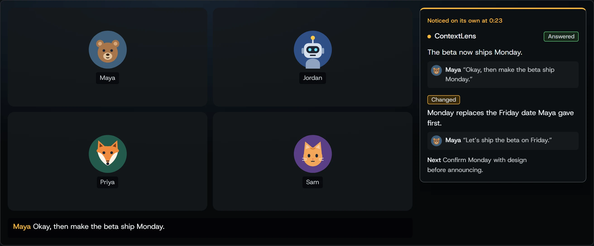
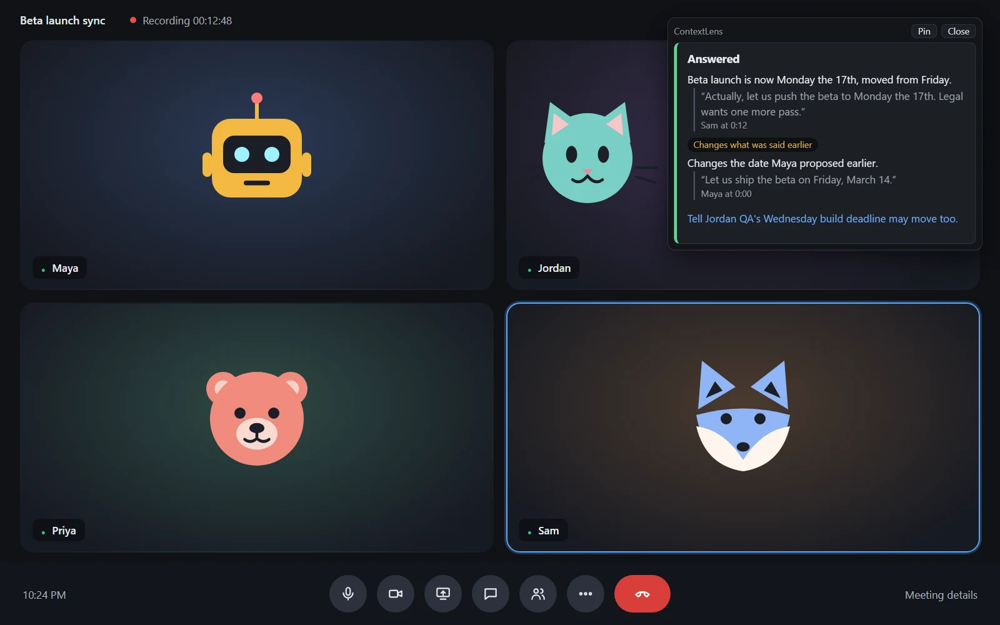
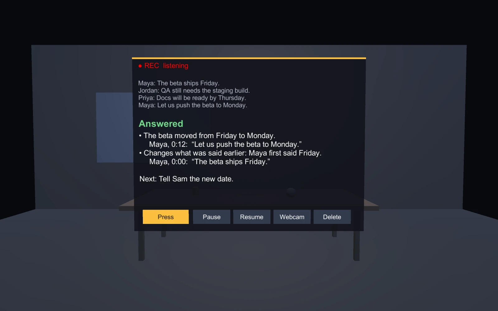
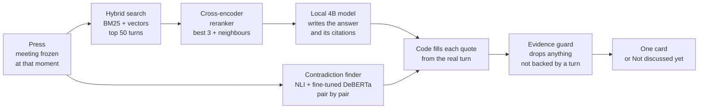
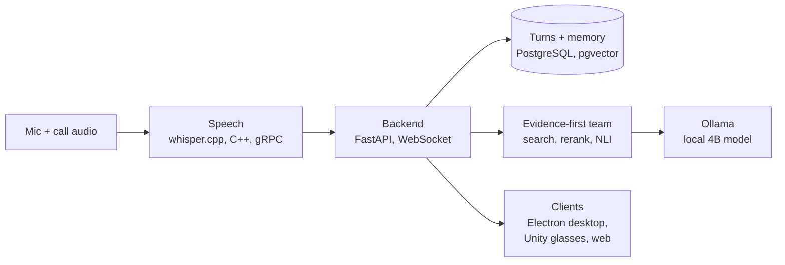

<div align="center">


# ContextLens Neo

### Lost the thread? Press one key.

A meeting copilot that runs on your own computer. Press once and a short card shows what was said, who said it and what changed, every line quoted from the conversation. On your desktop, or in your smart glasses.

      

[**Website**](https://contextlens.aakashsenthilnathan.com) · [Watch it work](site/room.html) · [Desktop](site/desktop.html) · [Glasses](site/glasses.html) · [How it's built](site/specs.html) · [Report](docs/REPORT.md)



</div>

## What it does

1. **It listens.** Speech is transcribed and labelled by speaker as the meeting goes, all on your machine.
2. **You press.** A global hotkey on desktop, a tap on glasses. When something changes or contradicts what was said earlier, it speaks up on its own.
3. **You read one card.** The answer, the quote and who said it, with each line tied to the turn it came from. If nobody said it, the card says "Not discussed yet" instead of guessing.

<table>
<tr>
<td width="50%"></td>
<td width="50%"></td>
</tr>
<tr>
<td align="center"><b>Desktop</b>: tray app, global hotkey, always-on-top card (Electron)</td>
<td align="center"><b>Smart glasses</b>: the card in your view (Unity, XR toolkit)</td>
</tr>
</table>

## Results

Tested on 161 held-out cases built from long real meetings (QMSum and AMI), with answers and conflicts 10 to 60 turns back. Both versions ran on the same cases; answers were graded blind by Sonnet on 68 of them.

| | Routed agent team (before) | **Evidence-first (shipped)** |
|---|---|---|
| Answers graded correct | 57% | **65%** |
| Correct or partly correct | 75% | **90%** |
| Answers graded wrong | 25% | **10%** |
| Caught a contradiction or update | 13% | **87%** |
| False conflict alerts | 6.7% | **0%** |
| Cited evidence 10+ turns back | 40% | **60%** |
| Mean latency | 3.5 s | **2.6 s** |
| Tokens per card | 1,337 | **630** |

The original single agent got 35% of these answers right. Records: `E11-test-20261116T035600246259Z`, grades `E11G-test-20261116T040043299775Z`, single agent `E10-test-20261115T122222764794Z`.

| Component | Result |
|---|---|
| Contradiction checker (fine-tuned DeBERTa-v3) | F1 0.913 on DECODE with published labels, against 0.753 for a TF-IDF baseline |
| Hybrid retrieval (BM25 plus embeddings) | MRR 0.530 and recall at 5 of 0.700 on QMSum, 367 questions |
| Streaming speech (whisper.cpp tiny.en over gRPC) | word error rate 0.376 on AMI meetings |
| Fine-tuning vs prompting (QLoRA on a 2B base) | prompting shipped: the adapter abstained correctly on 0.438 of insufficient cases against 0.938 |

## How a press works

Code finds the evidence; the model only words it.



- **Frozen view.** A press reads the meeting as of that moment; nothing said afterwards can reach the answer.
- **Evidence first.** Hybrid search pulls 50 turns, a bge-reranker-v2-m3 cross-encoder keeps the best 3 with their neighbours, and `qwen3.5:4b` (through Ollama) writes a short answer citing them. Code fills each quote from the real turn, so a citation is always real.
- **Contradictions, checked in code.** A ModernBERT NLI model and the fine-tuned checker compare the latest turn with earlier turns about the same thing, and tell a contradiction from a legitimate update ("make that Monday" after "Friday").
- **A guard has the last word.** A statement stays only if it cites a turn that exists, before the press, whose text contains the quote, and every number in it appears in the quotes.

Deep dives: [system overview](docs/architecture/system.md) · [one press, step by step](docs/architecture/press-lifecycle.md) · [agents and guards](docs/architecture/agents-and-guards.md) · [retrieval and memory](docs/architecture/retrieval-and-memory.md) · [speech service](docs/architecture/speech-service.md) · [evaluation and claims](docs/architecture/evaluation-and-claims.md) · [desktop client](docs/architecture/desktop-client.md) · [website](docs/architecture/website.md)

## The stack



| Layer | Technology |
|---|---|
| Speech | C++17, whisper.cpp (ggml tiny.en), gRPC and protobuf, a voice gate and utterance segmenter, CMake and ctest, Docker (optional CUDA) |
| Speakers | pyannote diarization over a rolling window |
| Backend | Python 3.12, FastAPI, uvicorn, WebSockets, pydantic; one socket per conversation |
| Retrieval | BM25, embedding similarity (`nomic-embed-text`), reciprocal rank fusion, bge-reranker-v2-m3 cross-encoder |
| Memory | PostgreSQL with pgvector, or in memory; extracted decisions, commitments and corrections with `supersedes` links |
| Consistency | PyTorch and Transformers: DeBERTa-v3 fine-tuned on DECODE, ModernBERT NLI, pairwise matching with update and hedge rules |
| Models | `qwen3.5:4b-q4_K_M` through Ollama on your GPU; a cloud model never sees live audio or transcripts (Claude is used only for offline grading) |
| Agents | LangGraph and hand-written tool loops; an evidence-first team (default), a routed team, a single agent, all behind one interface with an 8 s deadline |
| Experiments | MLflow, JSON run records with seeds and prompt versions, bootstrap intervals, McNemar tests, a claims gate, PEFT QLoRA |
| Clients | Electron tray app (global hotkey, overlay), Unity C# client, React and TypeScript web client |
| Ops and quality | OpenTelemetry, Prometheus and Grafana (opt-in), pytest, ruff, JSON-schema contract checks, GitHub Actions |

## Quick start

Needs Python 3.12, Docker, Node.js and [Ollama](https://ollama.com). A GPU is recommended for the local model.

```
git clone https://github.com/aakashksen/ContextLens-Neo
cd ContextLens-Neo
py -3.12 -m venv .venv
.venv\Scripts\python -m pip install -e ".[dev,server,postgres,speech,audio]"
ollama pull qwen3.5:4b-q4_K_M
ollama pull nomic-embed-text
```

**Run everything** (Postgres, the speech service, the backend and the web client; Ctrl-C stops them):

```
py -3.12 tools\run_everything.py
```

**Desktop app:** `cd clients/desktop && npm install && npm run dist`, then run the installer from `clients/desktop/dist`. **Glasses:** open `clients/unity` in Unity 6000.3.3f1 and press Play. Full steps are on the [download page](site/download.html).

**Try it with no models at all:** `.venv\Scripts\python tools\fake_server.py` serves the same WebSocket contract with invented cards; or open `site/room.html` in a browser for the short demo meeting.

Optional: `HF_TOKEN=...` in a git-ignored `.env` turns on speaker labels (accept the pyannote model terms first). No other keys are needed.

## Tests and reproducing results

```
.venv\Scripts\python -m pytest -q
.venv\Scripts\python -m ruff check .
python -m contextlens.eval.claims check
python tools/check_report_numbers.py
```

The suite runs offline with fake models; tests that need a GPU, Ollama or a network are marked `real` and skipped by default. Every experiment writes a record to `results/`, and a number may appear in the report or this README only if a cited record backs it: `claims check` re-derives each claim and `check_report_numbers.py` fails on any number that isn't backed. More in [docs/TESTING.md](docs/TESTING.md).

## What's where

| Path | What it is |
|---|---|
| `src/contextlens/` | Agents, retrieval, guards, consistency, API, speech client, evaluation and experiments |
| `speech/` | The C++ whisper.cpp service (gRPC), Dockerfile and ctest suite |
| `clients/desktop/`, `clients/unity/`, `clients/web/` | Electron tray app, Unity glasses client, React web client |
| `site/` | The website, including the demo meeting |
| `docs/REPORT.md` | The full write-up: problem, architecture, data, every experiment |
| `docs/DESIGN.md`, `docs/DECISIONS.md` | What was built and why, with the options that lost |
| `docs/client-contract.md` | The WebSocket contract, with its JSON schema |
| `results/`, `configs/`, `datasets/` | Run records and claims, frozen experiment settings, split manifests |
| `tools/` | The launcher, the fake server, the meeting room, report and dataset checkers |
| `legacy/OfficialContextLens/` | The original hackathon version, unchanged |

<details>
<summary><b>How the build ran</b></summary>

The build was plan-driven and test-first. A written plan broke the work into tasks, each built test first in its own git worktree and closed only when the plan's acceptance commands passed. Selection rules were written before the runs they governed, and results that went against the builder (a rejected fine-tune, two dropped latency fixes, a team that first lost to one agent) are reported as they came out. The plan is [docs/PLAN.md](docs/PLAN.md) and the reasoning behind each choice is in [docs/DECISIONS.md](docs/DECISIONS.md); `py -3.12 tools\taskctl.py status` shows where it stands.

</details>

<details>
<summary><b>Data, licences and citations</b></summary>

The code is MIT. No dataset is redistributed except as noted, and each keeps its own terms; the full record, with source pages and the approval for each use, is [docs/datasets.md](docs/datasets.md).

| Source | Used for | Licence as recorded |
|---|---|---|
| **AMI Meeting Corpus** | Speech experiments and questions built from its annotations | CC BY 4.0, from the Hugging Face copy `edinburghcstr/ami`; committed AMI text (`datasets/ami-questions/` and the speech prediction files) is attributed here |
| **QMSum** | Retrieval benchmark and a card-writing training mix | Code MIT; the data states no licence and draws on AMI, ICSI (CC BY 4.0) and two parliaments whose terms were not confirmed. Used locally for non-commercial evaluation; not published here |
| **DECODE** | Contradiction detection | No data licence stated (ParlAI code is MIT). Used locally for non-commercial evaluation; not published here |
| **LongMemEval** | A small search-only slice | MIT; filler sessions from ShareGPT and UltraChat (Apache 2.0 and MIT as stated by the authors) |

Models keep their own licences: DeBERTa-v3, Qwen, nomic-embed-text, ModernBERT and the rerankers are MIT or Apache 2.0, the whisper.cpp tiny.en model is MIT, and the pyannote model is gated (accept its terms yourself).

The AMI Meeting Corpus (https://groups.inf.ed.ac.uk/ami/corpus/, licence at https://groups.inf.ed.ac.uk/ami/corpus/license.shtml) must be cited:

```bibtex
@inproceedings{carletta2005ami,
  author    = {Carletta, Jean and Ashby, Simone and Bourban, Sebastien and Flynn, Mike and
               Guillemot, Mael and Hain, Thomas and Kadlec, Jaroslav and Karaiskos, Vasilis and
               Kraaij, Wessel and Kronenthal, Melissa and Lathoud, Guillaume and Lincoln, Mike and
               Lisowska, Agnes and McCowan, Iain and Post, Wilfried and Reidsma, Dennis and Wellner, Pierre},
  title     = {The {AMI} Meeting Corpus: A Pre-announcement},
  booktitle = {Machine Learning for Multimodal Interaction (MLMI 2005)},
  series    = {Lecture Notes in Computer Science},
  volume    = {3869},
  pages     = {28--39},
  publisher = {Springer},
  year      = {2005}
}

@inproceedings{zhong2021qmsum,
  title     = {{QMS}um: A New Benchmark for Query-based Multi-domain Meeting Summarization},
  author    = {Zhong, Ming and Yin, Da and Yu, Tao and Zaidi, Ahmad and Mutuma, Mutethia and
               Jha, Rahul and Awadallah, Ahmed Hassan and Celikyilmaz, Asli and Liu, Yang and
               Qiu, Xipeng and Radev, Dragomir},
  booktitle = {Proceedings of NAACL},
  year      = {2021}
}

@inproceedings{nie2021decode,
  title     = {I like fish, especially dolphins: Addressing Contradictions in Dialogue Modeling},
  author    = {Nie, Yixin and Williamson, Mary and Bansal, Mohit and Kiela, Douwe and Weston, Jason},
  booktitle = {Proceedings of ACL},
  year      = {2021}
}

@inproceedings{wu2025longmemeval,
  title     = {{LongMemEval}: Benchmarking Chat Assistants on Long-Term Interactive Memory},
  author    = {Wu, Di and Wang, Hongwei and Yu, Wenhao and Zhang, Yuwei and Chang, Kai-Wei and Yu, Dong},
  booktitle = {Proceedings of ICLR},
  year      = {2025}
}
```

</details>

## Contact

**Aakash Senthilnathan**, Computer Science and Statistics & Data Science at UC Santa Barbara.
[LinkedIn](https://www.linkedin.com/in/aakashsenthilnathan/) · [GitHub](https://github.com/aakashksen) · aakash.senthilnathan@gmail.com

MIT [license](LICENSE) for the code written for this project; `legacy/`, datasets, pretrained weights and other third-party material keep their own terms.
