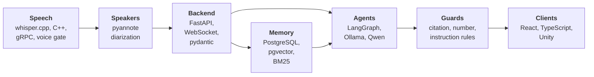
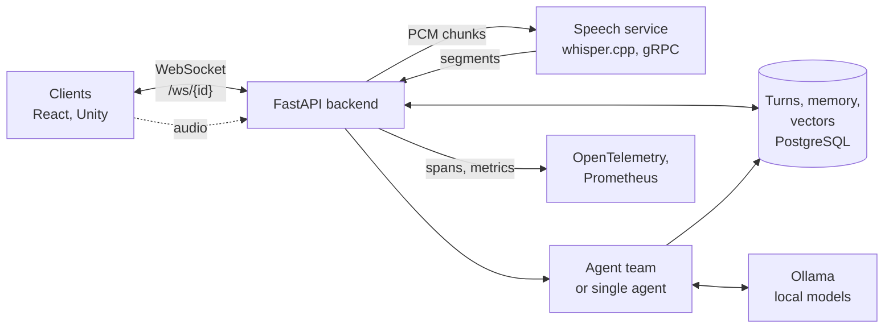
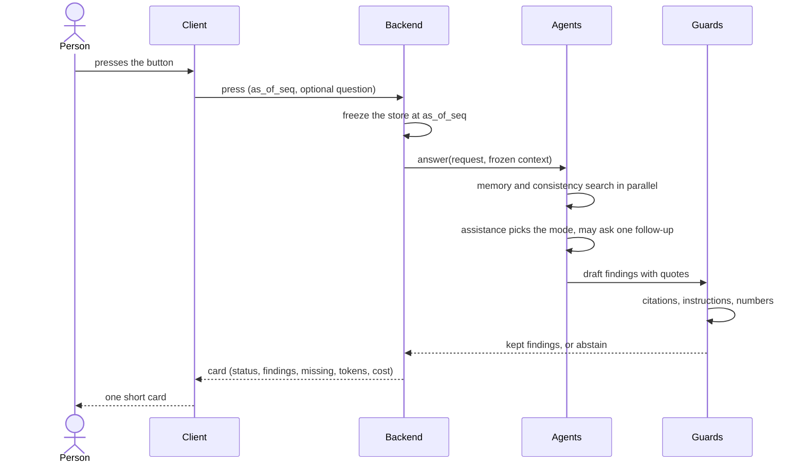
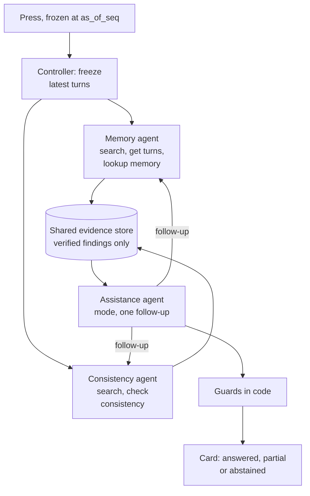
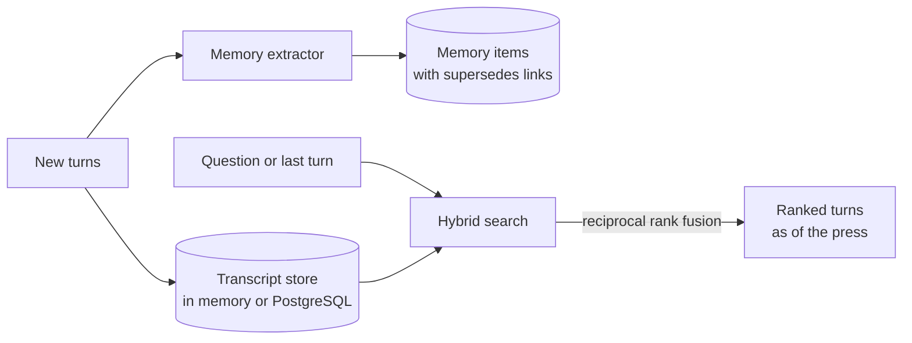
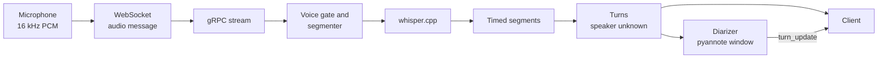
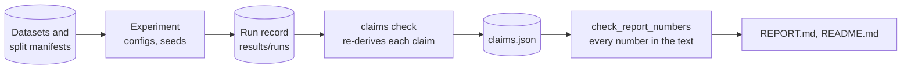
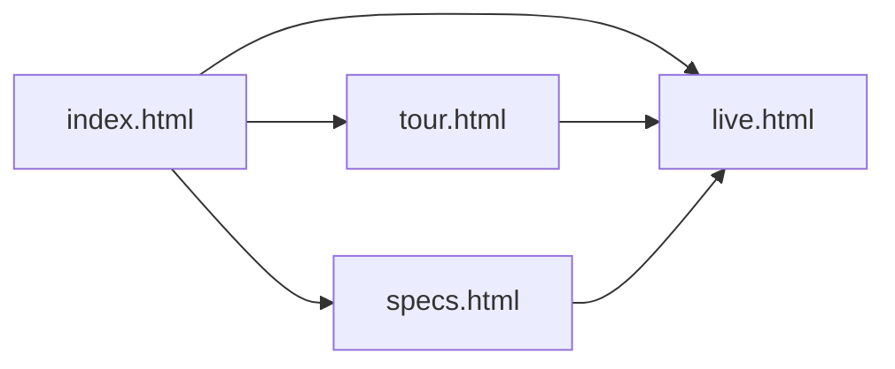

<div align="center">

# ContextLens Neo

**An on-demand conversation assistant**

Press a button in the middle of a conversation and get one short card built from what was actually said: something you missed, a possible inconsistency, or help responding. Every statement on the card cites the turn it came from, and "not enough information" is a valid answer.

     

[Website](site/index.html) · [Walkthrough](site/tour.html) · [How it's built](site/specs.html) · [Live demo](site/live.html) · [Report](docs/REPORT.md)

</div>

---

## Contents

[What it does](#what-it-does) · [Results](#results) · [The stack](#the-stack) · [System overview](#system-overview) · [One press](#one-press) · [Agents and guards](#agents-and-guards) · [Retrieval and memory](#retrieval-and-memory) · [Speech path](#speech-path) · [Evaluation](#evaluation-and-claims) · [Website](#website) · [Setup](#setup) · [Tests](#tests) · [Demo script](#demo-script) · [Reproduce a result](#reproduce-a-result) · [What's where](#whats-where) · [How the build ran](#how-the-build-ran) · [Data and licences](#data-and-licences) · [Contact](#contact)

## What it does

During a meeting, a class or a long discussion it is easy to lose track of what was said. ContextLens Neo answers one question at the press of a button: **what was actually said, and is there enough to say it?**

1. **Press the button.** The conversation is frozen at that moment. Nothing said afterwards can reach the answer.
2. **Code finds the evidence.** Search and a reranker pick the turns that answer the question, and a contradiction checker compares the latest turn with what was said earlier, separating a contradiction from a legitimate update ("make that Monday" after "Friday"). A small local model then writes the answer from those turns.
3. **A guard in code checks every claim.** A statement stays only if it cites a turn that exists, at or before the press, whose text contains the quoted words, and if every number in it appears in the quotes.
4. **One short card comes back.** Recall ("Maya said it exceeded the budget"), clarify ("earlier: Monday, now: Wednesday") or respond (a suggested reply, labelled as a suggestion). If nothing in the meeting answers, the card says "Not discussed yet" and shows the closest related point.

The design rules behind it: a wrong answer is worse than none, a suggestion must never look like something a person said, and a conflict is shown with its evidence and never as an accusation. The project was also built to be measured, so the same repository holds the experiments that compare a team of agents with one agent, prompting with fine-tuning, and a streaming speech stack, with every reported number traced to a run record.

## Results

**On long real meetings, code finds the evidence and the model only words it.** 161 held-out cases built from QMSum and AMI meetings, with answers and conflicts 10 to 60 turns back. Both versions ran on the same cases under the same conditions; answers graded blind by Sonnet on 68 of them (records `E11-test-20261116T035600246259Z`, grades `E11G-test-20261116T040043299775Z`).

| Measure | Routed team (before) | Evidence-first team (shipped) |
|---|---|---|
| answers graded correct | 57% | **65%** |
| correct or partly correct | 75% | **90%** |
| answers graded wrong | 25% | **10%** |
| caught a contradiction or update | 13% | **87%** |
| false conflict alerts | 6.7% | **0%** |
| cited evidence 10+ turns back | 40% | **60%** |
| mean latency | 3.5 s | **2.6 s** |
| tokens per card | 1,337 | **630** |
| cards cut at the 8 s deadline | 1.2% | **0%** |

The original single agent got 35% of these answers right (E10, `E10-test-20261115T122222764794Z`).

How a press works now: hybrid search pulls 50 turns, a cross-encoder reranker (bge-reranker-v2-m3) keeps the best 3 with their neighbours, and the 4B model writes a short answer citing them; code fills each quote from the real turn, so a citation is always real. Contradictions are found pair by pair: a ModernBERT NLI model and the fine-tuned checker score the latest turn against the earlier turns about the same thing. When nothing in the meeting answers, the card says "Not discussed yet" and shows the closest related point.

| Question | Result |
|---|---|
| Contradiction detection (fine-tuned DeBERTa-v3 checker) | contradiction F1 0.913 on DECODE, on published labels (TF-IDF baseline 0.753); macro-F1 0.729 on our test scenarios against 0.575 for a prompted checker and 0.189 for TF-IDF |
| Retrieval (hybrid BM25 plus embeddings) | on QMSum, on published labels: MRR 0.530 and recall at 5 of 0.700 over 367 questions |
| Streaming speech (whisper.cpp tiny.en over gRPC) | word error rate 0.376 and speaker error 0.599 on AMI meetings, after a per-meeting gain that normalizes rebuilt test audio (not a live feature) |
| Fine-tuning against prompting (QLoRA on a 2B base) | prompting stayed: the adapter answered nearly everything (0.962 of answerable cases) and abstained correctly on only 0.438 of insufficient ones against 0.938 |
| Injection guard (word patterns) | weak, and nothing claims protection: 14 of 60 orders caught, 0 of 60 ordinary turns dropped |

## The stack

Every layer, from the microphone to the card.



| Layer | Technology | Role |
|---|---|---|
| Speech service | C++17, whisper.cpp (ggml tiny.en model), gRPC and protobuf, CMake and ctest, Docker (optional CUDA build) | Streaming speech to text; an energy voice gate, a ring buffer and an utterance segmenter in front of the model |
| Speakers | pyannote speaker diarization, run in memory over a rolling window | Labels turns with speakers; without a token every turn stays `unknown` |
| Backend | Python 3.12, FastAPI, uvicorn, WebSockets, pydantic | One socket per conversation: audio in, transcript, speaker updates and cards out |
| Agents | LangGraph, hand-written tool loops, a controller with an 8 s deadline | A memory agent, a consistency agent and an assistance agent, or one agent with the same tools |
| Models | Ollama serving `qwen3.5:4b-q4_K_M` and `nomic-embed-text`; vLLM-style OpenAI-compatible and Hugging Face clients behind the same interface; Claude through the `claude -p` CLI for grading and comparison only | Local models run the product; a cloud model never sees live audio or transcripts |
| Retrieval | Plain-Python BM25, embedding cosine similarity, reciprocal rank fusion; optional MiniLM cross-encoder reranker (sentence-transformers) | Finds the turns most relevant to a question, never past the press |
| Memory | In-memory store or PostgreSQL with pgvector; an LLM memory extractor with `supersedes` links | Records decisions, commitments, questions, corrections and facts with the turns they came from |
| Consistency | PyTorch and Transformers: DeBERTa-v3-base fine-tuned on DECODE plus invented data; a prompted checker; a two-stage cascade | Tells contradiction from update from too little evidence |
| Fine-tuning | PEFT QLoRA, bitsandbytes, accelerate | The card-writing adapter that lost to prompting (E5) |
| Evidence guards | Plain Python: citation check, number rule, instruction rule | Drops anything not backed by a quoted turn; the model cannot argue with it |
| Observability | OpenTelemetry spans, Prometheus metrics, Grafana dashboard (opt-in profile) | Durations, tokens and cost per press; never transcript text |
| Clients | React and TypeScript with Vite and Vitest; a Unity C# client; a scripted fake server | The press button, transcript and cards |
| Experiments | MLflow, JSON run records with seeds and prompt versions, bootstrap intervals and McNemar tests | Reproducible comparisons and a claims gate |
| Quality | pytest, ruff, jsonschema contract checks, GitHub Actions | The whole suite runs offline with fake models |
| Website | Hand-written HTML, CSS and JavaScript, inline SVG, no framework and no build step | Home, walkthrough, architecture and a scripted live demo |

## System overview

A WebSocket backend sits between the clients and four services: the speech service, a store for turns and memory, local models, and the agents. A press never touches live state: it reads a frozen view of the store.



[**Full system overview**](docs/architecture/system.md)

## One press

The button sends a `press` message with the sequence number of the last turn heard. The backend freezes the store at that number, runs the assistant under a deadline, checks the card in code and sends it back.



[**Press lifecycle, step by step**](docs/architecture/press-lifecycle.md)

## Agents and guards



The agents share nothing but verified findings. The guard, not the prompt, decides what reaches the card: a prompt that asked the model to be honest about citations was tried and reverted. The single-agent system runs one tool loop with the same tools and the same guard, and is the efficient alternative.

[**Agents, tools, deadline and every guard**](docs/architecture/agents-and-guards.md)

## Retrieval and memory

Turns are stored one per row, with a speaker, a confidence and the time span. Search ranks turns by BM25 and by embedding cosine similarity and fuses the two rankings; every read is filtered to turns at or before the press. A memory extractor turns new turns into decisions, commitments, questions, corrections and facts, and a correction points at the item it replaces, so an update is not mistaken for a contradiction.



[**Search, memory and the frozen view**](docs/architecture/retrieval-and-memory.md)

## Speech path

A C++ service wraps whisper.cpp behind a gRPC stream. It gates out silence, cuts audio into utterances, transcribes them and returns timed segments; the backend turns segments into turns and a separate model labels the speakers in the background.



[**The speech service, the gate and speaker labels**](docs/architecture/speech-service.md)

## Evaluation and claims

Experiments E1 to E8 each write a record to `results/runs/`. A number may enter the report only through `results/claims.json`, which cites a record, and two checks refuse anything else.



[**Records, claims and the judge**](docs/architecture/evaluation-and-claims.md)

## Website

`site/` is a small static website: a home page, a walkthrough of one invented meeting in seven steps, an architecture page with the experiments and their failures, and a live demo that runs entirely in the browser. The demo is a scripted replay of two invented meetings; press a question and a card appears with the turns it cites. It needs no server and no network. The domain is not set yet, so there is no public address.



[**Pages, design tokens and the demo**](docs/architecture/website.md)

[**Desktop client: tray app, hotkey, overlay**](docs/architecture/desktop-client.md)

---

## Setup

Needs Windows or Linux, Python 3.12, Docker, Node.js and [Ollama](https://ollama.com). A GPU is optional for the product and needed only to reproduce training and the timed experiments.

```
py -3.12 -m venv .venv
.venv\Scripts\python -m pip install -e ".[dev,server,postgres,speech,audio]"
ollama pull qwen3.5:4b-q4_K_M
ollama pull nomic-embed-text
npm --prefix clients/web install
```

Optional: put `HF_TOKEN=...` in a git-ignored `.env` for speaker labels (accept the terms of the pyannote model first; see [docs/datasets.md](docs/datasets.md)). Without it every turn keeps the speaker `unknown` and nothing else changes. No other keys are used. Never commit `.env`.

For GPU PyTorch (the reranker and training), install the CUDA wheel that matches your driver:

```
.venv\Scripts\python -m pip install torch --index-url https://download.pytorch.org/whl/cu128
.venv\Scripts\python -m pip install sentence-transformers
```

## Tests

The whole suite runs offline and free: no GPU, no network, no model calls. It uses a fake model and fixtures.

```
.venv\Scripts\python -m pytest -q
.venv\Scripts\python -m ruff check .
npm --prefix clients/web test
```

Tests that need a GPU, Ollama or a network are marked `real` and are skipped by default. The C++ speech service has its own ctest suite that runs during the Docker build. How the layers fit together is in [docs/TESTING.md](docs/TESTING.md).

## Demo script

1. **Offline, no models.** The scripted server speaks the same WebSocket contract as the real backend with invented content:
   ```
   .venv\Scripts\python tools\fake_server.py
   npm --prefix clients/web run dev
   ```
   Open the address `npm` prints, with the server named in the address, as below. Four turns arrive; press the button and a card appears that cites the turn it relies on.
   ```
   http://127.0.0.1:5173/?server=ws://127.0.0.1:8000
   ```
2. **The real stack.** Start Ollama, then:
   ```
   py -3.12 tools\run_everything.py
   ```
   It starts Postgres with pgvector, the whisper.cpp speech service, the backend and the web client, and stops them on Ctrl-C ([docs/run-everything.md](docs/run-everything.md)). Open the same client address, allow the microphone, speak for a minute or two, and press "What was said?".
3. **What to look for.** Ask about something nobody said: the card should abstain. Say "make that Monday" after "Friday": the card should show both turns and call it an update, not a contradiction. A suggested reply is labelled as a suggestion.
4. **Switch the system behind the button** with `CONTEXTLENS_ASSISTANT` set to `team_rag` (the default), `team_routed`, `team`, `single` or `team_shipping_changed` before starting the backend. [docs/REPORT.md](docs/REPORT.md) says which of these was measured on the held-out test and which is the product default.

## Reproduce a result

Every experiment writes a record to `results/runs/`. Re-derive and recheck what the report says:

```
python -m contextlens.eval.claims check
python tools/check_report_numbers.py
```

`claims check` re-derives each entry of `results/claims.json` from its record (and re-runs each record's own checks); `check_report_numbers.py` fails if the report or this README contains a number that is not in a cited record. Experiments that need a GPU or a network are marked `real` and do not run by default; the experiment scripts are under `src/contextlens/experiments/`, one per experiment. The step-by-step version is in [docs/architecture/evaluation-and-claims.md](docs/architecture/evaluation-and-claims.md).

## What's where

| Path | What it is |
|---|---|
| `src/contextlens/` | Agents, retrieval, guards, consistency checker, API, speech client, evaluation and experiments |
| `speech/` | The C++ whisper.cpp service (gRPC), with its Dockerfile and ctest suite |
| `clients/web/`, `clients/unity/` | The React and TypeScript client and the rebuilt Unity client |
| `site/` | The website, including the scripted live demo |
| `docs/architecture/` | The deep dives linked above |
| `docs/REPORT.md` | The report: problem, architecture, data, every experiment, limits |
| `docs/DESIGN.md`, `docs/DECISIONS.md` | What was built and why, with the options that lost |
| `docs/PLAN.md`, `docs/TESTING.md`, `docs/CODEMAP.md` | The task plan, the testing and evaluation rules, and a map of the code |
| `docs/client-contract.md` | The WebSocket contract, with a JSON schema next to it |
| `docs/datasets.md` | Every dataset and model: source, licence, approval |
| `results/runs/`, `results/claims.json` | Experiment records, the only source of numbers, and the claims drawn from them |
| `datasets/`, `configs/` | Split manifests, scenarios written for this project, frozen experiment settings |
| `tools/` | The fake server, the one-command launcher, the report and dataset checkers, the plan state machine |
| `deploy/`, `docker-compose.yml` | Postgres with pgvector, the speech service (CPU or GPU) and opt-in Prometheus and Grafana |
| `legacy/OfficialContextLens/` | The original hackathon code, unchanged and read-only |

## How the build ran

The build was plan-driven and test-first. A written plan broke the work into tasks, each built test first in its own git worktree and closed only when the plan's acceptance commands passed. Every number in the report was traced to a run record, selection rules were written before the runs they governed, and results that went against the builder (the team result above, a rejected fine-tune, two dropped latency fixes) were reported as they came out. This describes how the project was made, not how to use it; the plan is [docs/PLAN.md](docs/PLAN.md) and the reasoning behind each choice is in [docs/DECISIONS.md](docs/DECISIONS.md). To see where the plan stands:

```
py -3.12 tools\taskctl.py status
```

## Data and licences

The code is MIT (see [License](#license)). No dataset is redistributed except as noted below, and each keeps its own terms; the full record, with source pages and the approval for each use, is [docs/datasets.md](docs/datasets.md).

| Source | Used for | Licence as recorded |
|---|---|---|
| **AMI Meeting Corpus** | Speech experiments (E7) and questions built from its annotations | CC BY 4.0. Text and audio come from the Hugging Face copy `edinburghcstr/ami`. AMI text that is committed (`datasets/ami-questions/` and the E7 prediction files) is attributed here |
| **QMSum** | Retrieval benchmark and a card-writing training mix | The code is MIT; the data states no licence and draws on AMI, ICSI (CC BY 4.0) and two parliaments whose terms were not confirmed. Used locally for non-commercial evaluation; its data and anything derived from it are not published here |
| **DECODE** | Contradiction detection (train, dev, test) | No data licence stated (the ParlAI code is MIT). Used locally for non-commercial evaluation; its data is not published here |
| **LongMemEval** | A small search-only slice | MIT (repository and dataset card); the filler sessions come from ShareGPT and UltraChat, whose terms the authors state as Apache 2.0 and MIT |

Models used keep their own licences too: DeBERTa-v3, Qwen, nomic-embed-text and the MiniLM reranker are MIT or Apache 2.0, the whisper.cpp tiny.en model is MIT, and the pyannote model is gated and needs you to accept its terms yourself.

The **AMI Meeting Corpus** is released under the Creative Commons Attribution licence and must be cited:

```bibtex
@inproceedings{carletta2005ami,
  author    = {Carletta, Jean and Ashby, Simone and Bourban, Sebastien and Flynn, Mike and
               Guillemot, Mael and Hain, Thomas and Kadlec, Jaroslav and Karaiskos, Vasilis and
               Kraaij, Wessel and Kronenthal, Melissa and Lathoud, Guillaume and Lincoln, Mike and
               Lisowska, Agnes and McCowan, Iain and Post, Wilfried and Reidsma, Dennis and Wellner, Pierre},
  title     = {The {AMI} Meeting Corpus: A Pre-announcement},
  booktitle = {Machine Learning for Multimodal Interaction (MLMI 2005)},
  series    = {Lecture Notes in Computer Science},
  volume    = {3869},
  pages     = {28--39},
  publisher = {Springer},
  year      = {2005}
}
```

The corpus is at https://groups.inf.ed.ac.uk/ami/corpus/ and its licence at https://groups.inf.ed.ac.uk/ami/corpus/license.shtml. The other three sources, which you should cite if you use them:

```bibtex
@inproceedings{zhong2021qmsum,
  title     = {{QMS}um: A New Benchmark for Query-based Multi-domain Meeting Summarization},
  author    = {Zhong, Ming and Yin, Da and Yu, Tao and Zaidi, Ahmad and Mutuma, Mutethia and
               Jha, Rahul and Awadallah, Ahmed Hassan and Celikyilmaz, Asli and Liu, Yang and
               Qiu, Xipeng and Radev, Dragomir},
  booktitle = {Proceedings of NAACL},
  year      = {2021}
}

@inproceedings{nie2021decode,
  title     = {I like fish, especially dolphins: Addressing Contradictions in Dialogue Modeling},
  author    = {Nie, Yixin and Williamson, Mary and Bansal, Mohit and Kiela, Douwe and Weston, Jason},
  booktitle = {Proceedings of ACL},
  year      = {2021}
}

@inproceedings{wu2025longmemeval,
  title     = {{LongMemEval}: Benchmarking Chat Assistants on Long-Term Interactive Memory},
  author    = {Wu, Di and Wang, Hongwei and Yu, Wenhao and Zhang, Yuwei and Chang, Kai-Wei and Yu, Dong},
  booktitle = {Proceedings of ICLR},
  year      = {2025}
}
```

## Contact

**Aakash Senthilnathan**, Statistics and Data Science at UC Santa Barbara.
[LinkedIn](https://www.linkedin.com/in/aakashsenthilnathan/) · [GitHub](https://github.com/aakashksen) · aakash.senthilnathan@gmail.com

## License

[MIT](LICENSE) for the code written for this project. `legacy/` (the original hackathon code) and the datasets, pretrained weights and other third-party material keep their own terms and are not covered by it.
