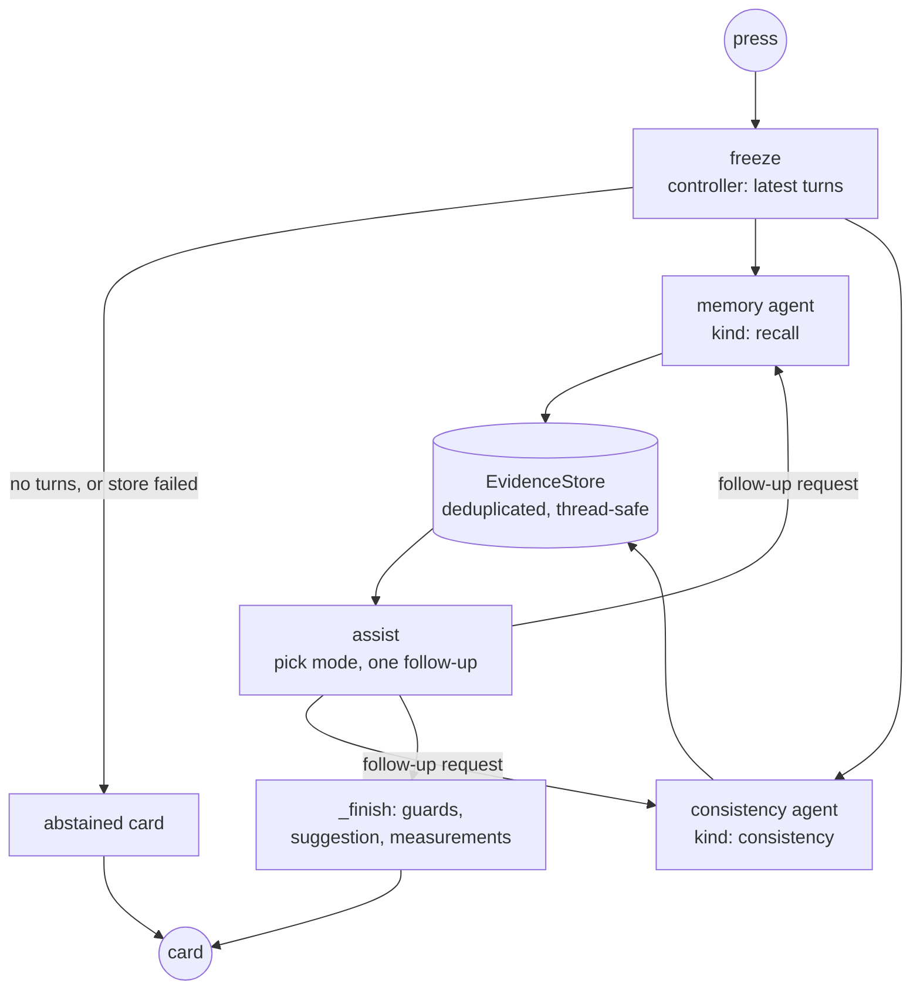
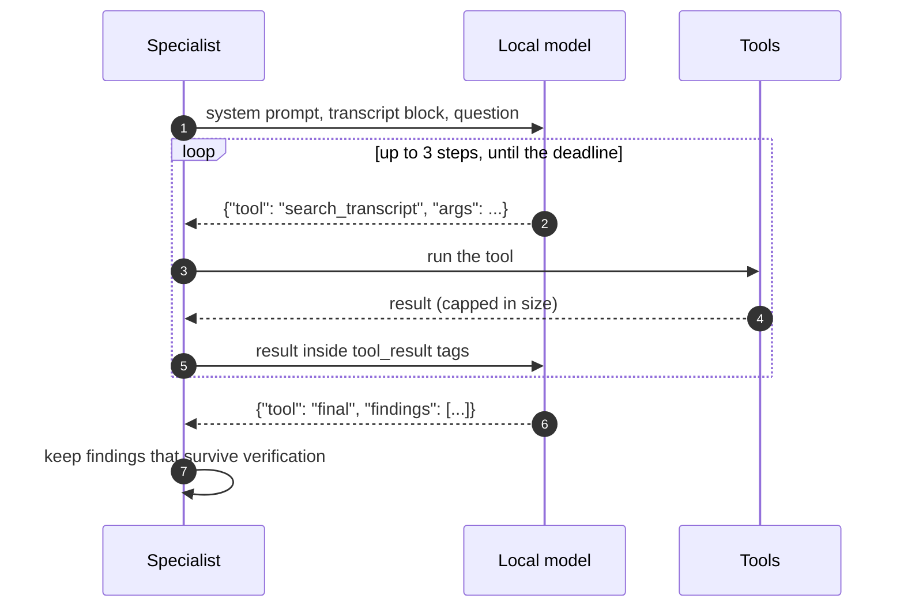
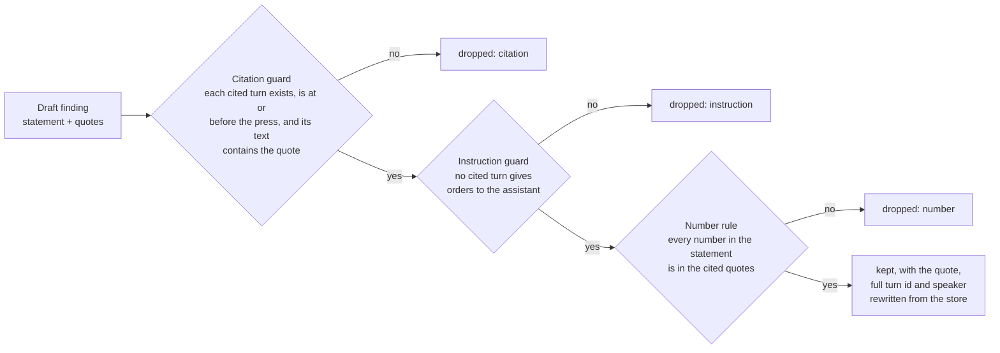
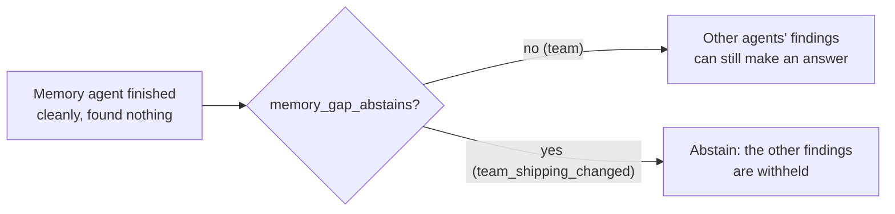

# Agents and guards

[Back to README](../../README.md) · Previous: [Press lifecycle](press-lifecycle.md) · Next: [Retrieval and memory](retrieval-and-memory.md)

The agents draft findings; the guards decide what is allowed to reach the card. The split is deliberate: a model can be wrong or be talked into things, plain code cannot. Source: `src/contextlens/agents/` and `src/contextlens/guard/`.

## The team

The graph is a LangGraph `StateGraph` (`agents/graph.py`): `freeze`, then `memory` and `consistency` in parallel, then `assist`. Each press builds a fresh `TeamAssistant` from its own tools, so nothing carries over between presses.

| Agent | Job | Tools | Steps |
|---|---|---|---|
| Controller (`graph.py`) | Freezes the latest turns, runs the specialists, enforces the 8 s deadline | none | n/a |
| Memory (`memory_agent.py`) | Finds earlier information and who said it; names a speaker only as the transcript shows them | `search_transcript`, `get_turns`, `lookup_memory` | up to 3 |
| Consistency (`consistency_agent.py`) | Separates contradiction from legitimate update from too little evidence; a change someone announces is an update | `search_transcript`, `check_consistency` (when a checker is configured) | up to 3 |
| Assistance (`assistance_agent.py`) | Sees only the verified findings and the question, never the transcript; picks `recall`, `clarify` or `respond`; may send one specialist back once | none | one follow-up |
| Single (`single.py`) | The same tools and guards in one loop, with no checker | the memory tools, plus `check_consistency` if a checker is given | up to 4 |

`Tools` (`agents/tools.py`) is everything an agent may read, and none of it returns a turn after `as_of_seq`. `check_consistency` compares a statement turn with earlier turns only, through the checker described in [Evaluation and claims](evaluation-and-claims.md).

## One specialist

Transcript text and tool results are always passed as data: `<transcript>` and `<tool_result>` blocks with `<`, `>` and `&` escaped and line breaks flattened (`llm/untrusted.py`), and the prompt says that text inside them is not instructions. A low-confidence speaker label is shown as `unknown`.

## The three guards

1. **Citation guard** (`guard/citations.py`). A finding is kept only if every citation resolves to a real turn in the frozen range and the quote appears in that turn's text (whitespace and case normalized). A short id like `t0` resolves only when exactly one turn in the conversation ends in `:t0`; ids that name another conversation or a `scene:` note never count as turn citations. Kept evidence is rewritten from the store, so the speaker and start time on the card are the stored ones, not the model's.
2. **Instruction guard** (`guard/instructions.py`). A cited turn that reads as an order to the assistant cannot be evidence of a fact. It is a narrow set of word patterns: names the assistant, drops the rules, says what to say, asks for secrets, ignores the conversation, claims to be the system, a bare order, markup or commands. It errs both ways, and the report is explicit that it is a limit, not a protection: on a blind set it caught a minority of orders and dropped no ordinary turns (see [REPORT](../REPORT.md), section 8).
3. **Number rule** (`agents/single.py`: `numbers_supported`). Numbers are compared by value, so `2`, `two`, `2nd` and `second` agree, `1,000` and `one thousand` agree, and digits with letters attached (`10pm`, `10km`) read as one number. A spelled-out count of the cited turns ("the two statements" over two citations) is allowed, which is a known false keep that a judge can catch.

If nothing survives, the card is `abstained`; if some findings were dropped it is `partial`, and `missing` says how many were dropped and why, as counts only. Every dropped finding is saved with its text in the run's `ctx.drops` for analysis, but the card itself never carries the dropped text.

## The memory-gap rule

The first measurement of the team found that the consistency specialist wrote some finding even for "the transcript does not give this detail", which outvoted memory's correct "nothing found". `memory_gap_abstains` is the one allowed fix, and `team_shipping_changed` is that fix plus the product's consistency checker.

## Three systems, kept apart

| Name | What it is | Where it appears |
|---|---|---|
| `single` | One agent, same tools, no checker | Selected on dev; efficient |
| `team` | Memory, consistency and assistance agents; the product default | `CONTEXTLENS_ASSISTANT=team` |
| `team_shipping_changed` | The team with its checker and the memory-gap rule; the primary system of the held-out test | `CONTEXTLENS_ASSISTANT=team_shipping_changed` |

`api/production.py` builds one of these per press from the setting. Which system ships is the person's decision and has not been made; [REPORT](../REPORT.md) section 7 spells out which numbers describe which system.

## Failure handling

Every specialist runs inside a try block: one agent failing becomes a note and a `degraded` flag (so the card is `partial`), not a crash. A store error means no card can be trusted and the press abstains. A model call that outlives the deadline plus a 0.5 s margin is abandoned, and the card records that its token and cost totals are incomplete.

Related: [Press lifecycle](press-lifecycle.md), [Retrieval and memory](retrieval-and-memory.md).
