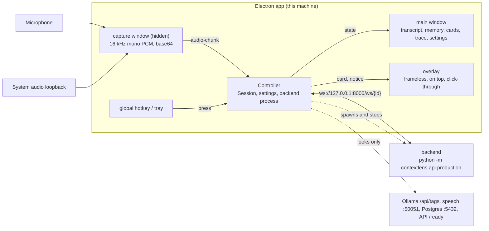

# Desktop client

[Back to README](../../README.md) · Related: [Press lifecycle](press-lifecycle.md), [Client contract](../client-contract.md)

`clients/desktop` is an Electron app that makes the existing `/ws/{conversation_id}` contract usable in a meeting. It adds no server code. It is a third client next to `clients/web` and `clients/unity`, and speaks the same protocol.



## Pieces

- `src/core/` has no Electron dependency. `protocol.js` and `session.js` port `clients/web/src/protocol.ts` and `session.ts` (audio leaves only while recording, a stale `recording` status after pause or delete is ignored, `turn_update` replaces by id). `card.js` renders a card and the optional trace with `textContent` only. `settings.js` validates settings and accelerators. `health.js` checks the four backend pieces. `backend.js` finds the repo and `.venv` Python and owns the backend child process (the whole tree is killed on stop).
- `src/main/controller.js` is the brain: it holds the one `Session`, reconnects every 3 s when the socket closes (turns and cards are kept, a user pause is re-sent after a reconnect), implements press, pause, resume and forget (delete, clear, new conversation id), and publishes one state snapshot to the windows. It is tested without Electron against `tools/fake_server.py`.
- `src/main/main.js` is the shell: tray, main window, overlay, hidden capture window, global hotkeys, media permissions and the IPC bridge. Renderers only see a small whitelisted API from `preload.cjs`.
- Capture runs in a hidden renderer because `getUserMedia` needs one. System audio uses `getDisplayMedia` with the main process answering through `setDisplayMediaRequestHandler` with `audio: 'loopback'`; video tracks are dropped at once. Both sources are summed into one `ScriptProcessor`, the same capture approach as `clients/web`.

## Backend start and the assistant

There is no per-press assistant field in the contract; `CONTEXTLENS_ASSISTANT` is read when the backend starts (`api/production.py`, `ASSISTANTS`). So the Assistant setting takes effect when the app starts the backend, and the default is `single_plus`. A backend started elsewhere keeps whatever it was started with. The app passes no other setting; database, speech address and tokens come from the user's environment.

## Optional card trace

The contract has no trace today. The desktop client reads an optional `card.trace` and optional `memory` messages, and shows an explicit "no trace" note when they are absent. Accepted shapes:

```json
{"trace": {"stages": [{"name": "retrieve", "ms": 120}], "specialist": "consistency", "checker": {"verdict": "pass"}, "guard_drops": ["no quote"]}}
{"type": "memory", "items": ["Ana will send the budget sheet on Monday"]}
```

`stage_ms` (a name to ms map), `specialists`, and `checker_verdict` are also read. Adding these fields to `api/contract.py` is a backend change and is not part of this client.

## Privacy

The app connects only to the configured server (localhost by default), the Ollama model list and TCP ports for the health panel, and the backend it spawns. It has no telemetry, crash reporter or updater, and it writes no transcript or audio to disk. Forget sends the contract's `delete` and drops the app's copy.

## Tests

`npm test` in `clients/desktop`: unit tests (protocol, session, card rendering, settings, health, backend process, controller), an end-to-end test that runs the real controller over a real WebSocket against `tools/fake_server.py`, and an Electron smoke test that launches the app hidden against the fake server, feeds fake audio, presses, and checks that the overlay really rendered the card. None of them call a model, Ollama or the speech service; the fake server runs on a free port, never 8000.
