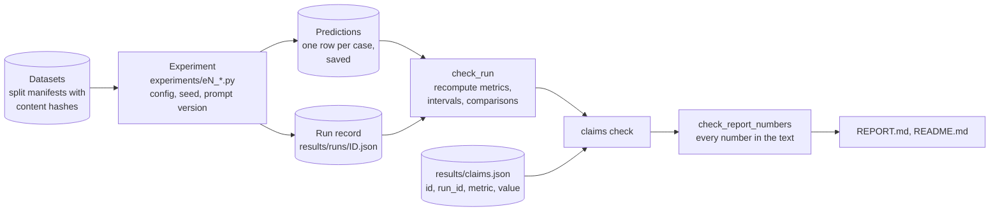
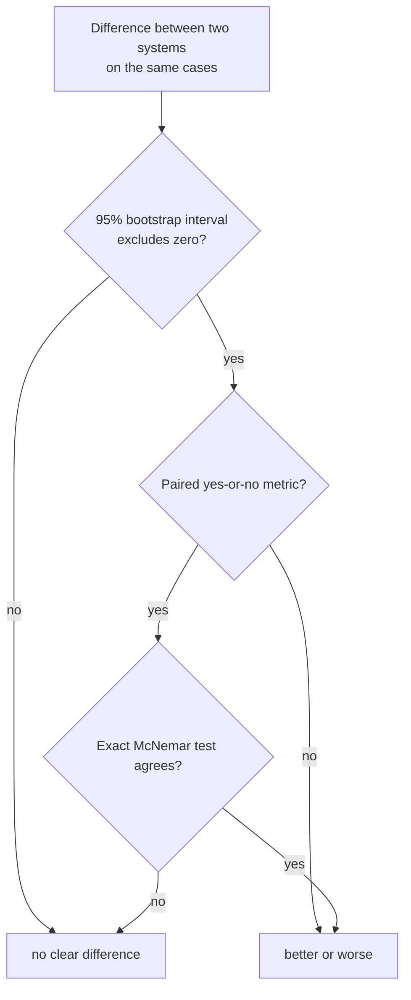
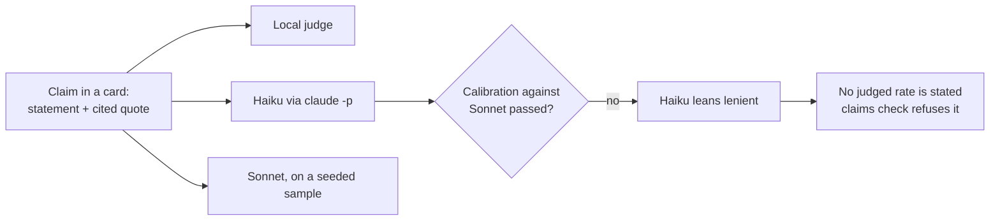
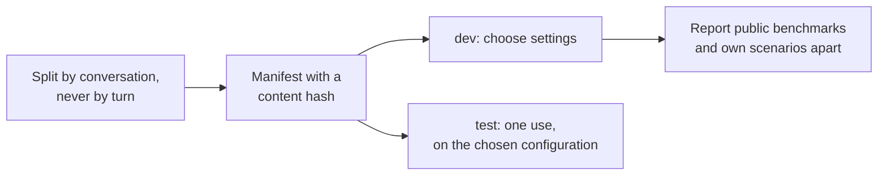

# Evaluation and claims

[Back to README](../../README.md) · Previous: [Speech service](speech-service.md) · Next: [Website](website.md)

The project was built to be measured, so the path from an experiment to a sentence in the report is itself a piece of software. A number may appear in `docs/REPORT.md` or the README only if a claim cites a run record, the record passes its own checks, and the claim agrees with the record. Source: `src/contextlens/eval/`, `src/contextlens/experiments/`, `tools/check_report_numbers.py`.

## From experiment to sentence



## What a run record holds

Every experiment writes `results/runs/<experiment>-<timestamp>.json` with: run id, experiment, git commit, dataset hash, split, config, models, prompt versions, `n`, metrics, intervals, comparisons, attempts (every setting tried, failures included), Claude calls used, whether labels were reviewed, and a path to the saved predictions per system. One record holds every system of the experiment, covering the same case ids. Because predictions are saved, `check_run` can recompute the metrics, the bootstrap intervals and the paired comparisons and fail if any saved figure differs. Records are never edited: a later record can list an earlier one in `supersedes` with a reason, and the file stays.

## How differences are called



The bootstrap resamples whole conversations (10,000 resamples, seed 13) and recomputes the actual metric on each resample, so every metric gets an interval. If a metric is undefined on any resample there is no interval, because dropping those resamples would bias it. A p-value saved on any metric other than a correct-or-incorrect outcome fails the check.

## Claims

A claim in `results/claims.json` names a run, a metric and a value, plus a `kind` that says where in the record to read it.

| Kind | Reads | Notes |
|---|---|---|
| `metric` (default) | A system's metric in the record | The system must be named if the record has several |
| `interval` | A saved bootstrap interval | |
| `comparison` | One field (`diff`, `ci`, `mcnemar_p`) of a saved pairwise comparison | |
| `benchmark` | A benchmark table in the record's config | Used for the DECODE, QMSum and detector figures |
| `guard` | A committed file under `results/guard-heldout/` | Must be tracked, unchanged against HEAD and added by the commit the claim names |

`python -m contextlens.eval.claims check` runs the full record check once per cited run and then, per claim, refuses it when:

- the value differs from the record, or the metric is undefined there;
- the record is superseded by a later one, or it is a test record that is not the one allowed use of the test split;
- the run's labels are not reviewed, or the labels come from the publisher and the claim's text does not say "on published labels";
- the metric is a judged one (groundedness, unsupported claims) and the record has no recorded judge and judge review.

## The report check

`python tools/check_report_numbers.py` reads `docs/REPORT.md` and `README.md` and fails on any number that is not in a run record a claim cites, on any placeholder that remains, and on an empty claims file. It matches numbers as printed: a value rounds to what is shown, a percent is read as a fraction, and a case count may be a record's `n` or a `cases` field. It reads numbers glued to `x`, `ms` or `s` (`9.9x`, `2400ms`) as numbers. The few things it does not read as numbers are narrow and tested: run ids, dates, "entry 41" references, `Python 3.12`, `recall@5`, heading numbers and list markers. Numbers inside fenced code blocks are not read, which is why diagrams and commands can use ports and sizes freely.

## The experiments

| ID | Question | Verdict in the report |
|---|---|---|
| E1 | Which retrieval setup finds evidence best? | Hybrid over one-turn chunks won by the rule written first; no claim that reranking helps; no E1 figure stated because the record fails its own check |
| E2 | What does each context shape add for a single model? | Memory raised answering and cut correct abstention; the cloud arm carries an old number-rule bug |
| E3 | Does a team beat one agent? | On dev the single agent abstained far better; a memory-gap fix was the one allowed repair |
| E4 | Does a trained consistency model beat baselines? | Trained model best accuracy, prompted checker far fewer false alarms; combined in a cascade |
| E5 | Does a fine-tuned small model write better cards? | No: it learned to answer nearly everything; prompting stayed |
| E6 | Which prompt choices move groundedness and abstention? | v3 selected by the rule; its groundedness gain was not confirmed by the second judge |
| E7 | What do live speech errors cost? | Streamed word error rate 0.376, speaker error 0.599 after a test-audio gain; latency figures are ceilings; two latency fixes dropped |
| E8 | The held-out test | Team clearly worse on tokens and median latency, no clear difference on quality |

Selection rules were written before the runs they governed, and each result was applied as written, including the ones that went against the builder.

## The judge, and why groundedness is withheld



Groundedness needs a judge of whether a cited quote supports a statement. Haiku failed its written calibration test against Sonnet and remains the judge only because local judging was ruled out, and no person reviewed any judge. So the code refuses every grounded-rate and unsupported-claim claim, the report states none, and they live only in the run records. Statements that restate a conflict ("A says X, B says not X") are where both judges wobble.

## Data hygiene



Our own scenarios are written conversations with a stated label per case; the dev split is 148 cases and the held-out test 136 card cases plus search-only cases from QMSum and LongMemEval, frozen before the test run (`configs/e8_freeze.json`). Extra dev cases built from templates are marked unreviewed in their records, and `claims check` refuses any figure from them. Dataset sources and licences are in `docs/datasets.md`, and a checker (`tools/check_datasets_doc.py`) fails if a required dataset section loses its licence or approval line.

## Reproducing a result

```
python -m contextlens.eval.claims check
python tools/check_report_numbers.py
python -m pytest -q tests/test_check_report_numbers.py
```

The first re-derives every claim from its record, including re-bootstrapping the intervals. The second checks the prose. Experiments that need a GPU or a network are marked `real` and do not run by default; each lives in `src/contextlens/experiments/` and takes its settings from `configs/`. A record that fails its own check, such as E1's, is left in place and its figures are simply not claimed.

Related: [Agents and guards](agents-and-guards.md), [Website](website.md).
