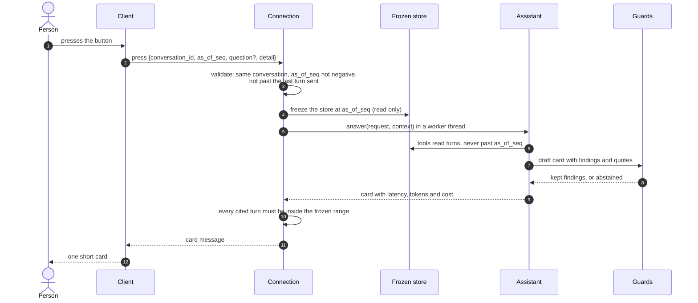
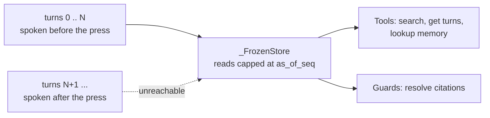
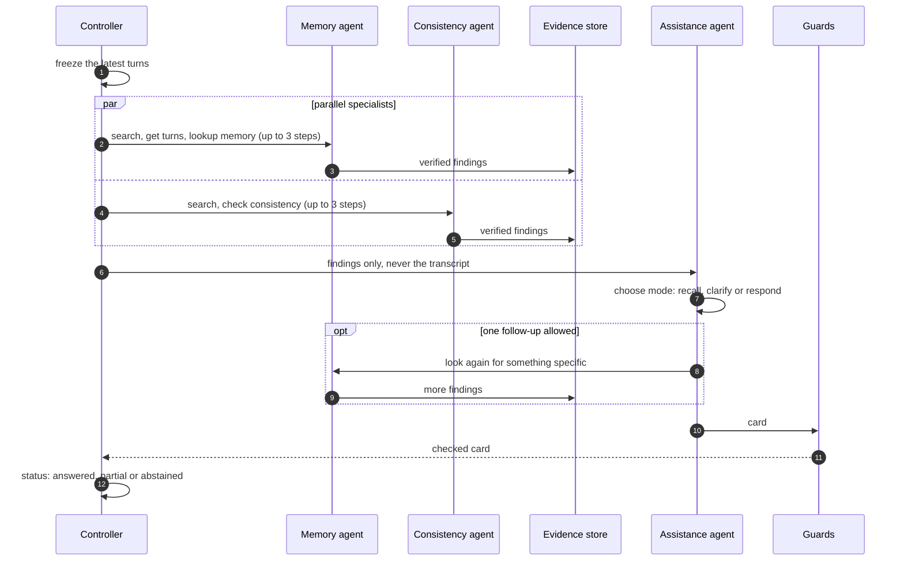
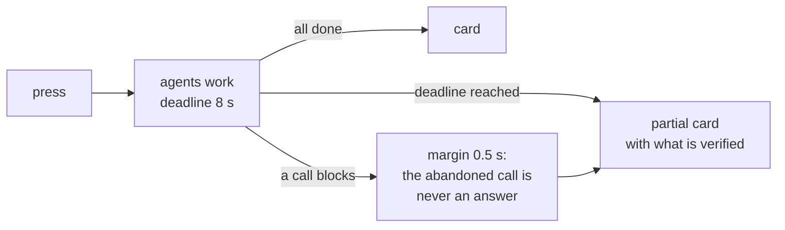
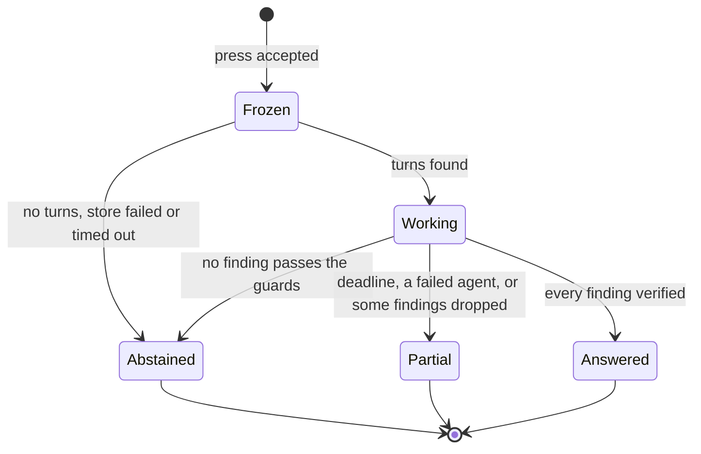

# Press lifecycle

[Back to README](../../README.md) · Previous: [System overview](system.md) · Next: [Agents and guards](agents-and-guards.md)

A press is one request: "what was actually said?" These diagrams follow it from the button to the card, through `api/stream.py`, `api/production.py`, `agents/graph.py` and `agents/single.py`.

## 1. Press to card

Invalid presses are answered with a `status` of `error` and a reason. A card that cites a turn outside the frozen range is refused before it is sent. The whole answer has a hard limit of 60 seconds (`answer_timeout_s`) on top of the assistant's own 8 s deadline.

## 2. The frozen view

Every retrieval and tool call filters on `as_of_seq`, and the store wrapper raises on any write, so a press cannot change the transcript or see a later turn. A test confirms that a later turn cannot appear in evidence.

## 3. Inside the assistant, in time

Specialists stop at the deadline; the controller returns whatever verified findings exist as a `partial` card. The single-agent system replaces the specialists and the assistance step with one tool loop of up to four steps and the same guards.

## 4. The deadline

A model call that blocks past the deadline is abandoned (at most 8 are left running at once, after which no new call starts), and anything it returns later is not used. The card records tokens and cost, and notes any abandoned call so the totals are known to be incomplete.

## 5. Card states

A card carries a `mode` (`recall`, `clarify` or `respond`), a `status`, its findings with quoted evidence, an optional suggestion, `missing` notes saying what was dropped and why (counts only), and its latency, tokens and cost. In respond mode a second model call writes the suggestion from the surviving statements only, and a number in it must also be in the quotes. A press with no question, on a latest turn that asks something (a question mark, or "please"), is set to respond in code, not by the model's guess.

Related: [Agents and guards](agents-and-guards.md), [Retrieval and memory](retrieval-and-memory.md).
