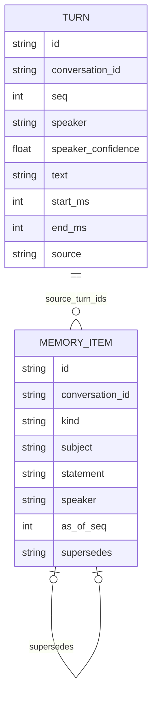
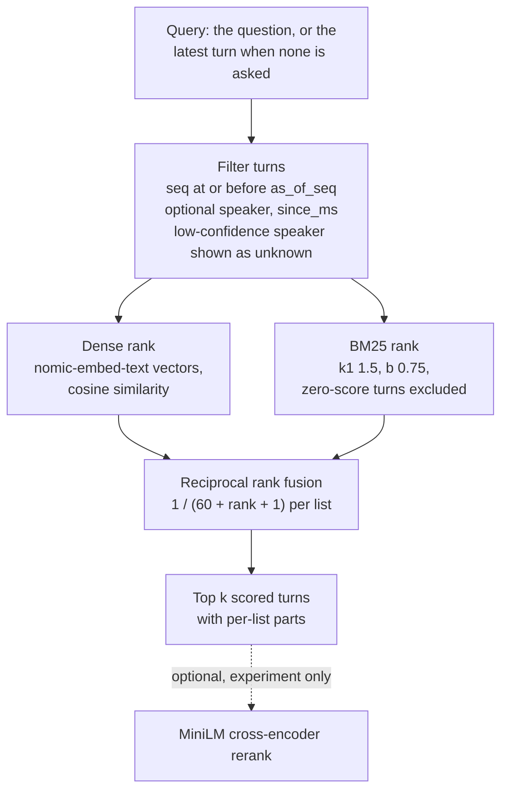
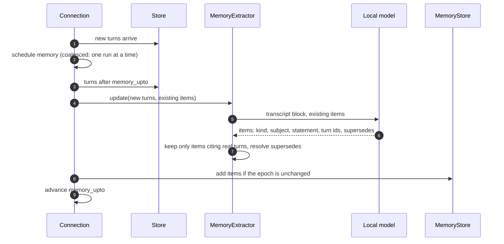
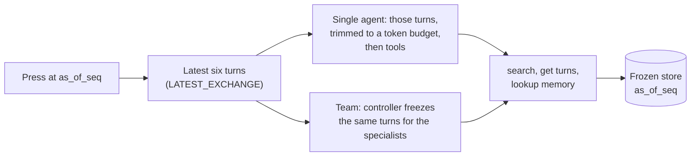
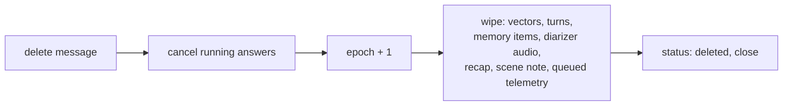

# Retrieval and memory

[Back to README](../../README.md) · Previous: [Agents and guards](agents-and-guards.md) · Next: [Speech service](speech-service.md)

Three things hold what was said: the transcript store (every turn, with its embedding), the memory store (decisions, commitments and corrections extracted from the turns), and a rolling recap that helps a model read but is never evidence. Search ranks turns; it never reaches past the press. Source: `src/contextlens/retrieval/`, `memory/`, `api/stream.py`.

## What is stored

A `Turn` (`schemas.py`) has a source of `dataset`, `synthetic` or `asr`. The `TranscriptStore` protocol has an in-memory implementation (tests, experiments) and `PostgresTranscriptStore`, which keeps each turn with a `pgvector` embedding column in one table indexed by conversation and sequence (`docker-compose.yml` runs the `pgvector/pgvector` image). Memory items are held in an in-process `MemoryStore`; their ids carry the sequence number of the newest turn read, so updates over different turns never share an id.

## Hybrid search

`Retriever.search` (`retrieval/hybrid.py`) supports `dense`, `bm25` and `hybrid` modes; the product uses `hybrid`. Scores are fused by rank, not by value, so the two scales never need calibrating. Document vectors come from the store's column when it has one and from a small cache otherwise; only the query is embedded per call. The reranker is not in the product: E1 found hybrid over one-turn chunks the best of eight settings by a rule written first, with reranking close to a tie, so no claim is made that it helps. The chosen setting and the rule are saved in `configs/retrieval.json`.

## Memory extraction, in the background

Extraction runs outside any card deadline, on its own thread, and only for turns it has not read. A press reads whatever memory exists at that moment; if extraction is behind, the press still works from the turns themselves. Items are:

| Kind | Example |
|---|---|
| `decision` | "launch moves to Friday" |
| `commitment` | "Ana will send the budget sheet" |
| `question` | an open question |
| `correction` | "make that Monday" |
| `fact` | anything else worth keeping |

A `correction` points at the item it replaces (`supersedes`, validated against items on the same subject). `lookup_memory` hides superseded items unless asked, which is how the memory agent can tell "Friday, then Monday" is an update and not two conflicting facts. An item's speaker is set only when all its source turns share one speaker, otherwise `unknown`.

## The rolling recap

`RollingSummary` (`memory/summary.py`) keeps a recap of at most 80 words, updated with each batch of new turns. It has `citable = False`: it helps a model read, it cannot be cited, and its failure never holds memory back.

## What each system sees at the press

With no question typed, the default ask is "say what is relevant from earlier in the conversation to the latest exchange"; a blank question counts as no question. The experiments compare other context shapes (recent turns only, the full conversation, retrieval, retrieval with memory) through assistants in `agents/single.py`; `context/budget.py` drops the oldest non-evidence sections when a token budget has to be met, and always keeps evidence. E2 found that the simple shapes abstained well but answered only about two thirds of answerable cases, and that adding memory raised answering and cut correct abstention (see [REPORT](../REPORT.md), E2).

## Delete

Background work records the epoch it started in and writes only if it is unchanged, so work that finishes after a delete changes nothing.

Related: [Agents and guards](agents-and-guards.md), [Speech service](speech-service.md).
