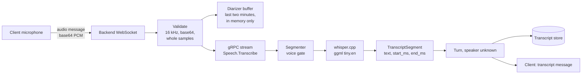
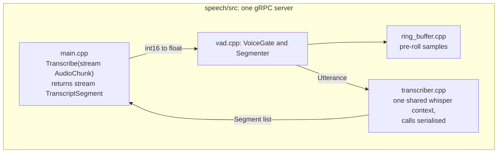
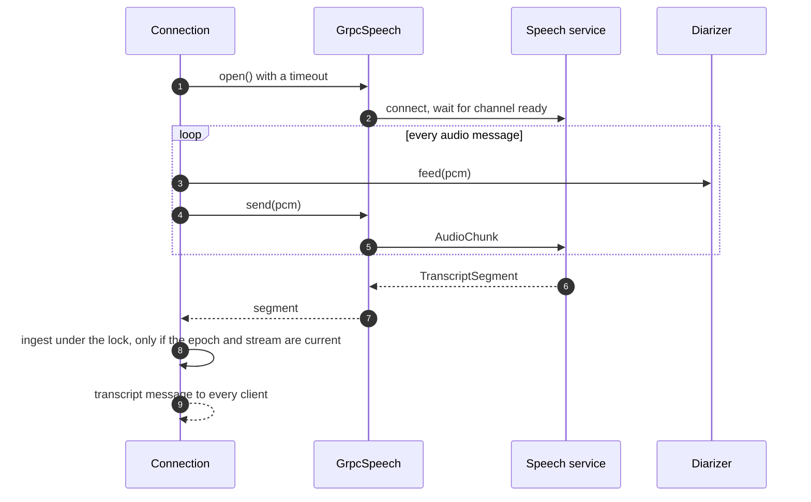
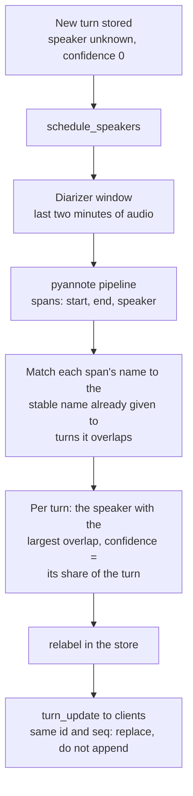

# Speech service

[Back to README](../../README.md) · Previous: [Retrieval and memory](retrieval-and-memory.md) · Next: [Evaluation and claims](evaluation-and-claims.md)

Speech goes in as 16 kHz mono 16-bit PCM and comes out as timed text segments, which the backend turns into transcript turns. A separate model names the speakers later, in the background. Source: `speech/` (C++), `src/contextlens/speech/` and `api/stream.py` (Python).

## The path of one utterance

## The C++ service

- **Contract** (`speech/proto/speech.proto`): a bidirectional stream. The client sends `AudioChunk{pcm}` of any size; the server sends `TranscriptSegment{text, start_ms, end_ms, is_final}` with times in milliseconds from the start of the stream, and reports its compute backend (`cpu` or `gpu:<name>`) as initial metadata under `x-compute-backend`. Every segment the service emits is final.
- **Voice gate** (`vad.cpp`): an energy gate on 20 ms frames. A frame is loud above a fixed RMS threshold, the gate stays open through a hangover after the last loud frame, a short pre-roll from a ring buffer is kept so word starts are not clipped, an utterance with too little loud audio is dropped, and a long one is cut at a maximum length. The settings are in `SegmenterConfig`.
- **Transcriber** (`transcriber.cpp`): one whisper.cpp model shared by every stream, calls serialised by a mutex. Segment times are shifted by the utterance start so they are relative to the whole stream.
- **Build** (`speech/Dockerfile`, `CMakeLists.txt`): C++17, gRPC and protobuf, whisper.cpp pinned to a release tag and built from source, a model file downloaded at a pinned revision and checked against a SHA-256, and `ctest` run during the image build so a broken build cannot produce an image. A GPU variant is the same file with CUDA base images (`docker compose --profile gpu`), and the service reports `gpu:<name>` only if whisper.cpp actually initialised that GPU.
- **Tests**: `speech/tests/test_core.cpp` covers the gate, the segmenter and the ring buffer without a model.

## The Python side

`GrpcSpeech` (`speech/client.py`) encodes and decodes the two protobuf messages by hand over a generic gRPC channel and bounds its send queue. If the service does not answer in time, or fails, the connection closes the stream, tells the client once that "audio is not being transcribed", and retries after a pause (10 s by default); the rest of the backend keeps working. `pause` makes the server ignore audio until `resume`, and a delete closes the stream so audio from before it cannot come back. A press is still answered while paused.

## Speaker labels

The pipeline names speakers afresh on every run, so `Diarizer.speaker_updates` maps its names onto stable ones (`speaker_1`, `speaker_2`, and so on) by overlap before relabelling. The speaker model is one shared instance, loaded once on a background thread, and runs serialised; speech heard before it has loaded stays `unknown`. It needs a Hugging Face token from an account that accepted the model's terms (`HF_TOKEN` in a git-ignored `.env`); without it every turn stays `unknown` and nothing else changes. Retrieval treats a speaker with confidence below 0.5 as `unknown`, so a weak label is never presented as fact.

## What the speech experiments found

E7 streamed whole AMI meetings through this service at four times real speed. The streamed word error rate was at first far worse than offline Whisper on the same audio. An offline control showed why: the fixed loudness gate dropped most quiet speech. Rebuilt meetings were given one gain each before streaming, which brought streamed word error rate to 0.376 and speaker error to 0.599 on AMI's published labels. That gain is a normalization of rebuilt test audio, computed over a whole meeting, and a live system cannot do it. The fixed gate in the product still drops quiet microphones, and an adaptive gate is listed in `docs/backlog.md`. See [Evaluation and claims](evaluation-and-claims.md) and [REPORT](../REPORT.md), E7.

Related: [System overview](system.md), [Retrieval and memory](retrieval-and-memory.md).
