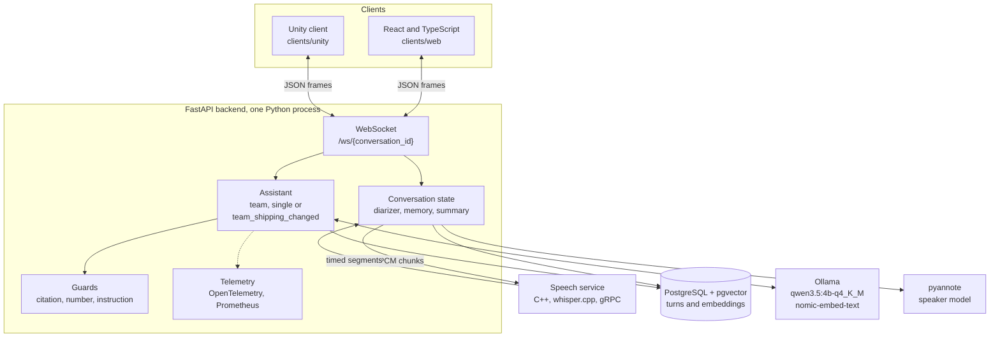
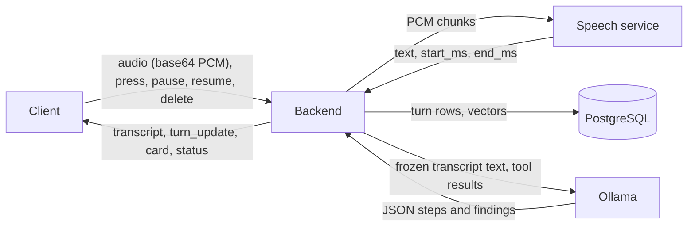
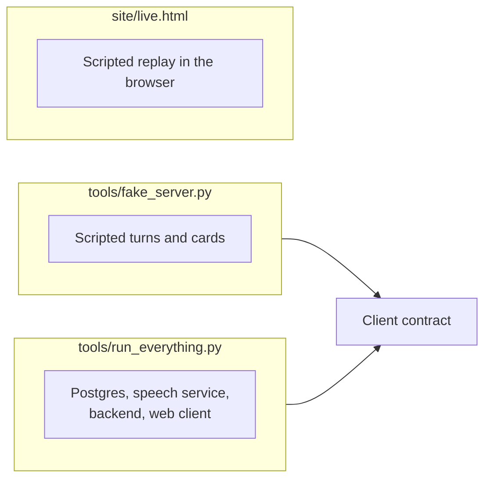

# System overview

[Back to README](../../README.md) · Next: [Press lifecycle](press-lifecycle.md)

ContextLens Neo has five running parts: clients, one FastAPI backend, a C++ speech service, a store for turns and memory, and local models served by Ollama. The agents live inside the backend process. Experiments, training and the website sit outside the running product.

## Where everything runs

## Who owns what

| Part | Owns | Never does |
|---|---|---|
| Client | Recording indicator, pause, delete, the press button, rendering cards | Decide what a card says |
| WebSocket layer (`api/stream.py`) | One connection per client, the frozen view for each press, epochs that make delete safe | Let a press read a turn after its `as_of_seq` |
| Speech service (`speech/`) | Voice gating, utterances, whisper.cpp transcription | Know about speakers, conversations or cards |
| Transcript store | Turns, speakers, confidence, embeddings | Accept writes during a press (`_FrozenStore` raises) |
| Agents (`agents/`) | Searching, checking and drafting findings under a deadline | Cite anything the guards cannot verify |
| Guards (`guard/`, `agents/single.py`) | What reaches the card | Call a model for citation or number checks |
| Telemetry (`obs/tracing.py`) | Durations, token counts, bounded labels | Record transcript text |

## Data that crosses each boundary

The message types are defined once, in `src/contextlens/api/contract.py`; the same file produces `docs/client-contract.schema.json`, which the Unity client is checked against (`tools/check_unity_schema.py`). Raw audio is never written to disk: the diarizer keeps only the most recent two minutes in memory. Live paths use local models only; a cloud model is used by experiments for grading and comparison, on benchmark text and invented scenarios.

## Three ways to run it

The fake server speaks the same contract with invented content, so a client can be built and tested with no models. `run_everything.py` starts the real stack and stops what it started on Ctrl-C. The website's live demo needs neither: it is a scripted replay inside the page, shaped after the fake server and the contract.

## Startup and readiness

The backend loads both models when it starts and keeps them loaded (a 30 minute `keep_alive`). Until both are loaded, `GET /ready` answers 503 and a WebSocket is closed with code 1013 (try again later), so a press never races a cold model load. If Ollama is down the loads are retried every 5 seconds and `/ready` names the failing model.

Related: [Press lifecycle](press-lifecycle.md), [Speech service](speech-service.md).
