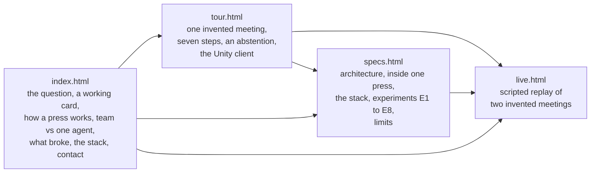
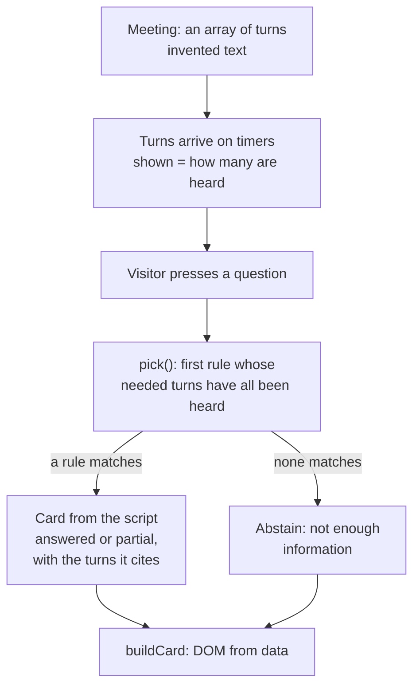

# Website

[Back to README](../../README.md) · Previous: [Evaluation and claims](evaluation-and-claims.md) · Start: [System overview](system.md)

`site/` is plain HTML, CSS and JavaScript with no framework and no build step. Open `site/index.html` in a browser, or serve the folder with any static host. The domain is not set yet, so there is no public address; every page works from the folder as it is. The live demo runs entirely in the browser.

## Pages

| File | What it shows |
|---|---|
| `index.html` | The question, a working card with two questions to press, how a press works, the team against one agent, what broke on the way, the stack, contact |
| `tour.html` | One invented meeting followed through seven steps (speech to turns, memory, the press, retrieval, agents, the guard, the card), then an abstention and the Unity client |
| `specs.html` | Architecture diagrams, the stack, experiments E1 to E8 as expandable entries with the rule written first and the failures, the limits |
| `live.html` | A scripted replay of two invented meetings: turns arrive one by one, you press a question, a card appears |
| `tokens.css`, `base.css`, `site.css` | Design tokens (a dark "Console" theme: colours in OKLCH, spacing and type scales), resets, and shared styles |
| `site.js`, `live.js` | The home page card, the open-all toggle, and the live demo |

## The live demo, and why it needs no server

Each question in `live.js` has ordered rules; a rule applies only once the turns it needs have been "heard". So pressing "When does it ship?" before the correction arrives gives a different card from pressing it after, and a question nobody answered gives the abstention card. Before any turn has arrived, the demo says nothing has been heard and makes no card. The cards are shaped after `tools/fake_server.py` and `docs/client-contract.md` (status `answered`, `partial` or `abstained`; findings cite only turns spoken before the press), but this is a script, not the real agents. All content is invented.

## Rules the site keeps

- **Every number comes from `docs/REPORT.md`.** Where the report withholds a figure (groundedness), the page says it is not published.
- **Text from script goes through `textContent`**, never `innerHTML`; DOM is built from data with a small `el()` helper, so nothing inserted by script is parsed as HTML.
- **Progressive enhancement.** The pages are complete HTML; script only adds the interactive parts (a `js` class on the root reveals them), and the open-all buttons stay hidden without it.
- **Pressed states** use `aria-pressed`.
- **Design tokens** live in `tokens.css`; shared styles in `site.css`. The one external dependency is Google Fonts (Host Grotesk and Atkinson Hyperlegible Mono), with system fallbacks.

Related: [System overview](system.md), [Evaluation and claims](evaluation-and-claims.md).
